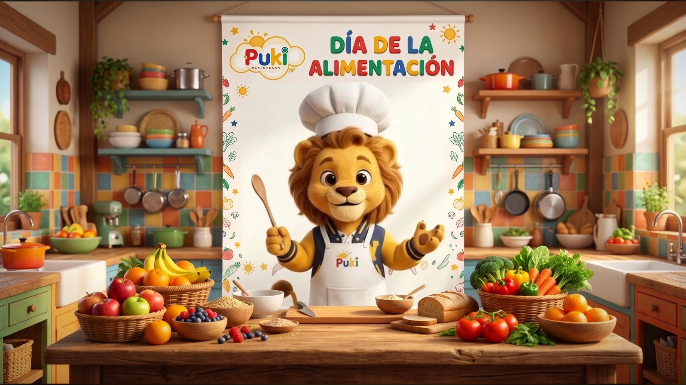

# PUKI · Proyectos Educativos

Repositorio de aplicaciones web del **Preescolar Puki**.

## La Cocina Mágica de Yellow

PWA educativa de preescolar con dos modos: exploración de los seis grupos alimenticios y el reto del Plato Mágico. Incluye siete recetas, 28 ingredientes, videos secuenciados de Yellow detrás de la puerta, carruseles educativos, validación de recetas, sonidos, confeti y funcionamiento offline.

- [Aplicación web](cocina-magica/index.html)
- [Instrucciones y estructura](cocina-magica/README.md)
- **URL de producción:** https://puki-blue.vercel.app/cocina-magica/

## Meet The Masters

Aplicación web interactiva del **Preescolar Puki** para el proyecto **Meet The Masters**. Presenta a 18 grandes personajes de la historia junto a la mascota Yellow y el alumno o alumna asignado a cada fecha.

- [Aplicación web](meet-the-masters/index.html)
- [Instrucciones, estructura y edición de datos](meet-the-masters/LEEME.md)
- [Tarjeta para compartir por WhatsApp](meet-the-masters/imagenes/compartir-whatsapp-cuadrada.jpg)
- **URL de producción:** https://puki-blue.vercel.app/meet-the-masters/

## Día Mundial de la Amabilidad

PWA táctil para el aula de preescolar. Los niños encienden cinco orbes de buenas acciones, completan la ventanita del corazón de Yellow y lo acompañan en su transformación en superhéroe. Incluye videos con sonido, tres celebraciones rotativas de Yellow, instalación como aplicación y funcionamiento offline.

- [Aplicación web](dia-mundial-amabilidad/index.html)
- [Instrucciones y estructura](dia-mundial-amabilidad/README.md)
- **URL de producción:** https://puki-blue.vercel.app/dia-mundial-amabilidad/

## Día de la Alimentación

Pantalla inmersiva para el **Día de la Alimentación**. La cocina ilustrada con el pendón de Puki queda al frente y tres videos verticales de Yellow se reproducen en secuencia continua dentro del recorte transparente del pendón, con doble buffer para evitar cortes.

- [Aplicación web](dia-de-la-alimentacion/index.html)
- [Instrucciones y estructura](dia-de-la-alimentacion/README.md)
- **URL de producción:** https://puki-blue.vercel.app/dia-de-la-alimentacion/

## El Castillo de los Sueños

Experiencia narrativa e interactiva inspirada en Walt Disney y sus talleres creativos. La fachada del castillo da paso al patio interno, a la historia de Walt Disney y a los talleres de música, video y dibujo. Está pensada para pantallas táctiles escolares y también funciona con ratón y teclado.

- [Aplicación web](castillo-de-los-suenos/index.html)
- [Instrucciones y estructura](castillo-de-los-suenos/README.md)
- **URL de producción:** https://puki-blue.vercel.app/castillo-de-los-suenos/

## La Noche del Nacimiento

Experiencia navideña interactiva para pantallas táctiles grandes. Un nacimiento en 3D recibe a los niños en el centro del árbol; cinco esferas abren historias por capítulos y la consola tallada de la mesa reproduce música con control de volumen y atenuación automática durante la lectura.

- [Aplicación web](la-noche-del-nacimiento/index.html)
- [Instrucciones y estructura](la-noche-del-nacimiento/README.md)
- **URL de producción:** https://puki-blue.vercel.app/la-noche-del-nacimiento/

## Despliegue en Vercel

Los seis proyectos son sitios estáticos que no requieren compilación. El repositorio está conectado a Vercel y cada push a la rama `main` actualiza el despliegue automáticamente.

La configuración compartida de Vercel está en [vercel.json](vercel.json). La Cocina Mágica y Día Mundial de la Amabilidad añaden cabeceras específicas para sus service workers y manifests; sus recursos de desarrollo y fuentes originales se excluyen del deploy mediante [.vercelignore](.vercelignore).

## Uso local

- **La Cocina Mágica:** abre `cocina-magica/index.html` o ejecuta `node server.js` dentro de `cocina-magica/`.
- **Meet The Masters:** abre `meet-the-masters/index.html` en un navegador moderno.
- **Día Mundial de la Amabilidad:** dentro de `dia-mundial-amabilidad/`, ejecuta `node servidor.mjs --open` o abre `iniciar.cmd`.
- **Día de la Alimentación:** abre `dia-de-la-alimentacion/index.html` en un navegador moderno.
- **El Castillo de los Sueños:** abre `castillo-de-los-suenos/index.html` o ejecuta `node servidor-local.js` dentro de `castillo-de-los-suenos/`.
- **La Noche del Nacimiento:** abre `la-noche-del-nacimiento/index.html` o sirve la carpeta con `python -m http.server` para evitar restricciones del navegador.

Las seis aplicaciones están pensadas para pantalla horizontal.

## Proyecto

Preescolar Puki · Proyectos escolares **La Cocina Mágica de Yellow**, **Meet The Masters**, **Día Mundial de la Amabilidad**, **Día de la Alimentación**, **El Castillo de los Sueños** y **La Noche del Nacimiento**.
