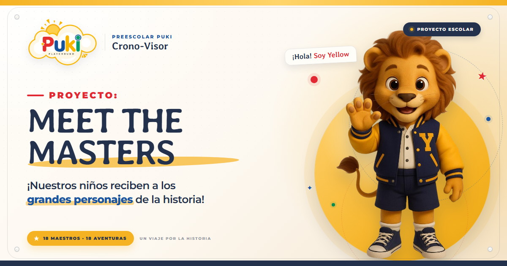

# PUKI · Meet The Masters

Aplicación web interactiva del **Preescolar Puki** para el proyecto **Meet The Masters**. Presenta a 18 grandes personajes de la historia junto a la mascota Yellow y el alumno o alumna asignado a cada fecha.



## Contenido

- [Aplicación web](meet-the-masters/index.html)
- [Instrucciones, estructura y edición de datos](meet-the-masters/LEEME.md)
- [Tarjeta para compartir por WhatsApp](meet-the-masters/imagenes/compartir-whatsapp.jpg)

## Despliegue en Vercel

El proyecto es un sitio estático que no requiere compilación.

1. Importa este repositorio en [vercel.com/new](https://vercel.com/new).
2. En **Root Directory**, selecciona `meet-the-masters`.
3. Usa **Framework Preset: Other**.
4. Deja vacíos **Build Command** y **Output Directory**.
5. Pulsa **Deploy**.

La app quedará publicada en la raíz del dominio de producción de Vercel:

```text
https://TU-PROYECTO.vercel.app/
```

Cada push a la rama `main` actualizará el despliegue automáticamente.

## Uso local

Abre `meet-the-masters/index.html` en un navegador moderno. La aplicación está diseñada para **pantalla horizontal**; en vertical muestra una pantalla que invita a girar el dispositivo.

## Proyecto

Preescolar Puki · Proyecto escolar **PROYECTO: MEET THE MASTERS**
