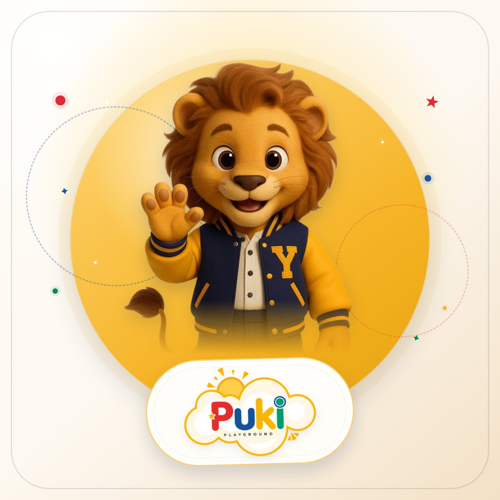

# PUKI · Meet The Masters

Aplicación web interactiva del **Preescolar Puki** para el proyecto **Meet The Masters**. Presenta a 18 grandes personajes de la historia junto a la mascota Yellow y el alumno o alumna asignado a cada fecha.



## Contenido

- [Aplicación web](meet-the-masters/index.html)
- [Instrucciones, estructura y edición de datos](meet-the-masters/LEEME.md)
- [Tarjeta para compartir por WhatsApp](meet-the-masters/imagenes/compartir-whatsapp-cuadrada.jpg)

## Despliegue en Vercel

El proyecto es un sitio estático que no requiere compilación.

La aplicación está desplegada en:

```text
https://puki-blue.vercel.app/meet-the-masters/
```

El repositorio está conectado a Vercel y cada push a la rama `main` actualiza el despliegue automáticamente.

## Uso local

Abre `meet-the-masters/index.html` en un navegador moderno. La aplicación está diseñada para **pantalla horizontal**; en vertical muestra una pantalla que invita a girar el dispositivo.

## Proyecto

Preescolar Puki · Proyecto escolar **PROYECTO: MEET THE MASTERS**
