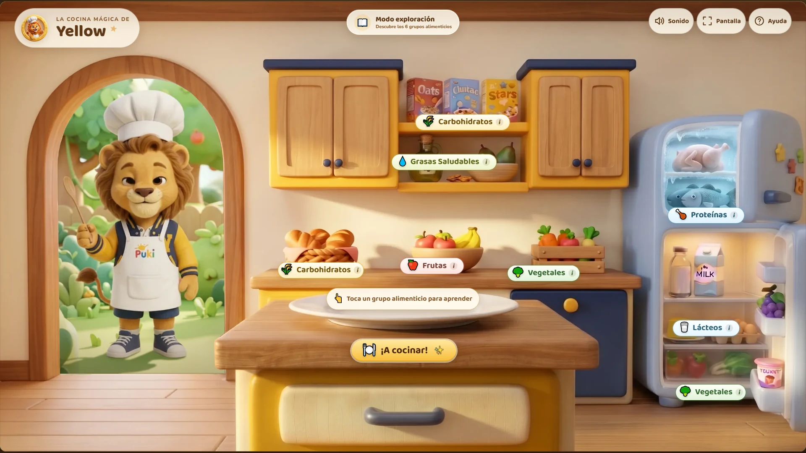
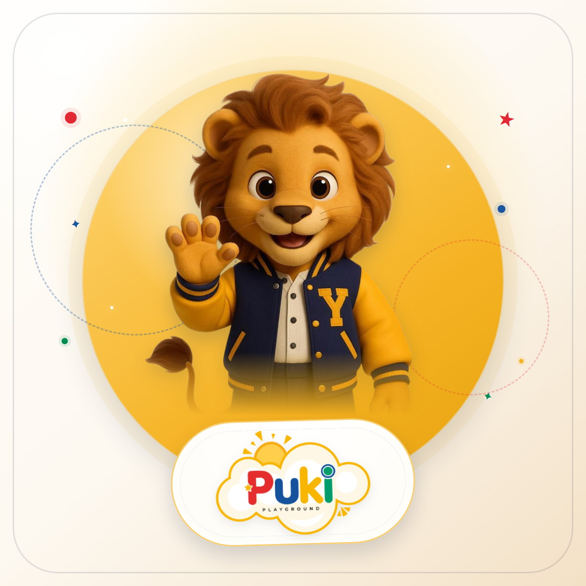

# PUKI · Proyectos Educativos

Repositorio de aplicaciones web del **Preescolar Puki**.

## La Cocina Mágica de Yellow

PWA educativa de preescolar con dos modos: exploración de los seis grupos alimenticios y el reto del Plato Mágico. Incluye videos secuenciados de Yellow detrás de la puerta, carruseles educativos, validación de recetas, sonidos, confeti y funcionamiento offline.

- [Aplicación web](cocina-magica/index.html)
- [Instrucciones y estructura](cocina-magica/README.md)
- **URL de producción:** https://puki-blue.vercel.app/cocina-magica/

## Meet The Masters

Aplicación web interactiva del **Preescolar Puki** para el proyecto **Meet The Masters**. Presenta a 18 grandes personajes de la historia junto a la mascota Yellow y el alumno o alumna asignado a cada fecha.

- [Aplicación web](meet-the-masters/index.html)
- [Instrucciones, estructura y edición de datos](meet-the-masters/LEEME.md)
- [Tarjeta para compartir por WhatsApp](meet-the-masters/imagenes/compartir-whatsapp-cuadrada.jpg)
- **URL de producción:** https://puki-blue.vercel.app/meet-the-masters/

## Despliegue en Vercel

Ambos proyectos son sitios estáticos que no requieren compilación. El repositorio está conectado a Vercel y cada push a la rama `main` actualiza el despliegue automáticamente.

La configuración compartida de Vercel está en [vercel.json](vercel.json). La Cocina Mágica añade cabeceras específicas para su service worker y su manifest; sus recursos fuente originales se excluyen del deploy mediante [.vercelignore](.vercelignore).

## Uso local

- **La Cocina Mágica:** abre `cocina-magica/index.html` o ejecuta `node server.js` dentro de `cocina-magica/`.
- **Meet The Masters:** abre `meet-the-masters/index.html` en un navegador moderno.

Ambas aplicaciones están pensadas para pantalla horizontal.

## Proyecto

Preescolar Puki · Proyectos escolares **La Cocina Mágica de Yellow** y **Meet The Masters**.
