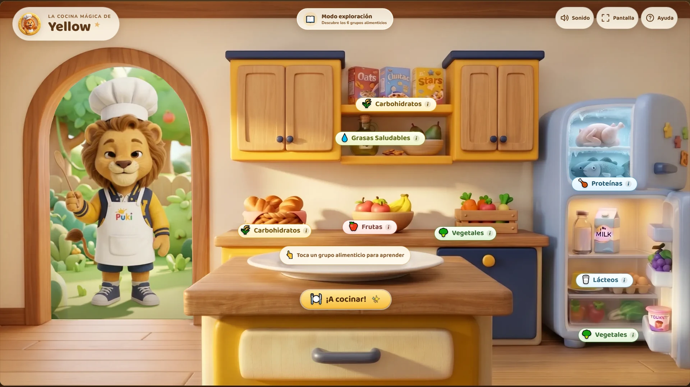
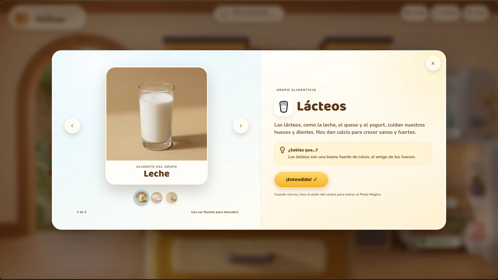
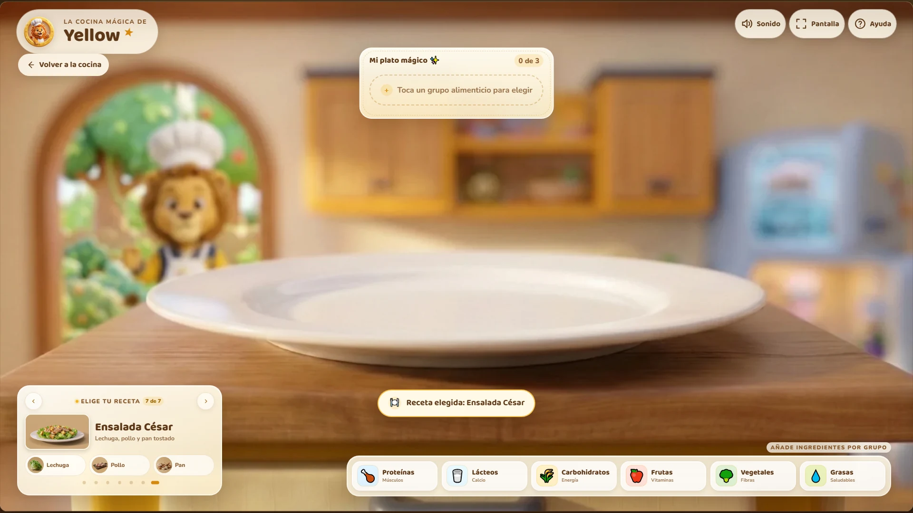

# 🦁 La Cocina Mágica de Yellow



PWA educativa para preescolar dividida en **dos modos independientes**:

1. **Modo Exploración:** una cocina informativa para aprender los seis grupos alimenticios.
2. **Modo Plato Mágico:** el reto de cocina con recetas, ingredientes y celebración.

Diseñada para pantallas táctiles grandes, proyectores de clase y tabletas en horizontal.

## Cómo abrir el juego

Necesitas Node.js 18 o superior. Desde esta carpeta:

```bash
node server.js
```

También puedes usar `npm start` (o `npm.cmd start` si PowerShell bloquea los scripts `.ps1`). Luego abre **http://localhost:4173** en Chrome, Edge o Safari.

Para cambiar el puerto:

```powershell
$env:PORT=4180; node server.js
```

> Abrir `index.html` con doble clic permite jugar, pero los videos locales y el modo offline de la PWA necesitan un servidor. Usa `node server.js` para la experiencia completa.

### Instalar como aplicación

1. Abre el juego en Chrome o Edge desde `localhost` o HTTPS.
2. Pulsa el icono de instalar de la barra de direcciones (o el menú › **Instalar La Cocina Mágica de Yellow**).
3. Se abrirá como ventana propia, en horizontal.

El service worker guarda imágenes, videos, fuentes y sonidos de la interfaz. Después de la primera carga puedes jugar sin internet.

## Publicación en Vercel

La Cocina Mágica se publica desde el repositorio `danielhenao1-spec/puki` en:

```text
https://puki-blue.vercel.app/cocina-magica/
```

El repositorio está conectado a Vercel y cada `git push` a la rama `main` genera un deploy automático. La configuración compartida del repositorio define las cabeceras del service worker y del manifest, y excluye del deploy las carpetas originales `imagenes/` y `videos/`, ya que la app usa las copias optimizadas de `assets/`. No se necesita ninguna variable de entorno.

## Cómo se juega

### Modo 1 · Exploración y aprendizaje

La pantalla principal es **100 % informativa**. No hay bandeja de ingredientes ni tarjeta de receta.

1. Toca una etiqueta de **grupo alimenticio**: Proteínas, Lácteos, Carbohidratos, Frutas, Vegetales o Grasas Saludables.
2. Se abre un lightbox educativo con dos partes:
   - **Izquierda:** un carrusel interactivo con los alimentos del grupo (flechas, miniaturas y deslizamiento táctil).
   - **Derecha:** el nombre del grupo y una explicación corta pensada para niños de 5 años.
3. Cierra el panel con **¡Entendido!**. Nada se agrega al plato en este modo.

### Modo 2 · El reto del Plato Mágico

Solo se entra tocando el **plato vacío del centro** o el botón **¡A cocinar!**.

1. La escena hace zoom al plato y aparecen la bandeja superior, el carrusel de recetas y los grupos alimenticios.
2. Elige una receta con las flechas o los puntos del carrusel.
3. Toca un grupo para abrir su selector y añade ingredientes. Los ingredientes también están agrupados por grupo alimenticio, no por mueble.
4. La bandeja superior muestra los ingredientes separados por **+**. La **X roja** quita uno.
5. Si un ingrediente no pertenece a la receta, vibra en rojo y aparece un aviso amable con un sonido suave.
6. Al añadir el último ingrediente, el selector muestra **¡Ver mi plato!**. La celebración comienza cuando se cierra esa ventana, para que el plato final y el confeti se vean completos.
7. El plato se transforma con un fundido, suena la celebración y aparece confeti de estrellas, sin voz.
8. **Cocinar otra vez** repite la misma receta; **Otra receta** avanza el carrusel y vacía el plato.





### Recetas incluidas

| Receta | Ingredientes | Plato final |
| --- | --- | --- |
| Desayuno Campeón | Harina de maíz, huevos y aguacate | Arepa con huevo y aguacate |
| Almuerzo de los Súper Amigos | Arroz, pollo y papa | Arroz con pollo y puré de papa |
| Súper Merienda Colorida | Cereal, leche, bananas y fresas | Cereal con leche, banana y fresa |
| Ensalada de Frutas Colorida | Bananas, fresas, patilla y naranja | Ensalada de frutas fresca |
| Pasta Boloñesa Infantil | Pasta, carne, tomate y queso | Pasta con carne y queso |
| Pabellón Criollo | Arroz, carne, caraotas y plátanos | Pabellón criollo |
| Ensalada César | Lechuga, pollo y pan | Ensalada César con crutones |

## Controles para dar clase

- **Sonido:** activa o silencia los efectos de sonido. La preferencia se recuerda en el dispositivo.
- **Pantalla:** entra o sale de pantalla completa. También intenta bloquear la orientación horizontal en móviles compatibles.
- **Ayuda:** explica los dos modos y los pasos del juego.
- **Flechas del carrusel:** cambian de alimento en el lightbox educativo o de receta en el Plato Mágico.
- **Volver a la cocina:** regresa al Modo Exploración sin perder el avance del Plato Mágico.

Los botones son grandes y accesibles con teclado. `Esc` cierra los paneles; las flechas del teclado navegan el carrusel educativo.

## Personaje y transición de video

- Los clips actuales (`1-v2.mp4`, `2.mp4` … `5.mp4`) se reproducen en serie, en bucle y sin cortes visibles.
- Van en una capa **detrás** de `cocina-fondo.webp`. El hueco transparente del arco de la puerta deja ver a Yellow, alineado con el marco.
- Se usan dos elementos `<video>`: mientras uno se reproduce, el siguiente se precarga y entra de forma cruzada al terminar.
- El video se pausa al salir de la cocina o al ocultar la pestaña para ahorrar recursos.

## Estructura

```text
.
├── index.html               # Escena, interfaz y plantillas base
├── styles.css               # Diseño 16:9, hotspots, modales y animaciones
├── app.js                   # Estado del juego, recetas, validación, video y audio
├── manifest.webmanifest     # Metadatos de instalación
├── sw.js                    # Cache offline y soporte de rangos para video
├── server.js                # Servidor local sin dependencias
├── icons/                   # Iconos PWA normales y maskable
├── assets/
│   ├── fonts/               # Baloo 2 y Nunito locales
│   ├── images/
│   │   ├── ingredients/     # 28 ingredientes optimizados
│   │   ├── cocina-fondo.webp
│   │   ├── plato-*.webp     # Platos terminados
│   │   ├── preparar-*.webp  # Vista previa de cada receta
│   │   └── yellow-chef.webp
│   └── videos/              # Secuencia 1-v2.mp4, 2.mp4 … 5.mp4
├── imagenes/                # Material original (sin modificar)
└── videos/                  # Videos originales (sin modificar)
```

## Editar recetas, grupos o ingredientes

Todo el contenido está en las constantes al inicio de `app.js`:

- `GROUPS`: nombre, explicación, dato curioso, color e icono de cada grupo alimenticio.
- `RECIPES`: título, ingredientes y plato final de cada receta.
- `INGREDIENTS`: nombre, grupo alimenticio e imagen de cada ingrediente.
- `GROUP_INGREDIENTS`: orden de los alimentos dentro de cada carrusel y selector.

Los hotspots del Modo 1 están definidos en `index.html` con `data-info-group`. Se pueden repetir varios puntos pequeños para un mismo grupo (por ejemplo, carbohidratos junto al cereal y junto al pan). Los botones del Modo 2 usan `data-picker-group`.

Si añades una imagen nueva, recuerda incluirla también en la lista `PRECACHE` de `sw.js` y cambiar `CACHE_VERSION` para que los dispositivos actualicen el contenido.

## Notas

- La app no usa voz sintetizada. La retroalimentación de errores y las celebraciones son visuales y sonoras.
- Los videos necesitan que el navegador permita reproducción automática silenciada. Si el personaje no aparece en la puerta, toca una vez la pantalla.
- El service worker requiere `localhost` o HTTPS. Si sirves el juego por IP de red local en HTTP, el juego funciona, pero la instalación y el modo offline pueden no estar disponibles en ese equipo.
- Los assets originales de `imagenes/` y `videos/` se conservan sin cambios. El juego utiliza copias optimizadas en `assets/`.
- Los grupos alimenticios incluyen todos los alimentos disponibles en los assets: **Caraotas** está en Proteínas y **Plátanos** en Frutas.
- **Lácteos** es un grupo independiente: leche, queso y yogurt tienen su propio hotspot, carrusel y botón de selección.

Hecho con cariño para Pequeñines Chefs. 🍳
