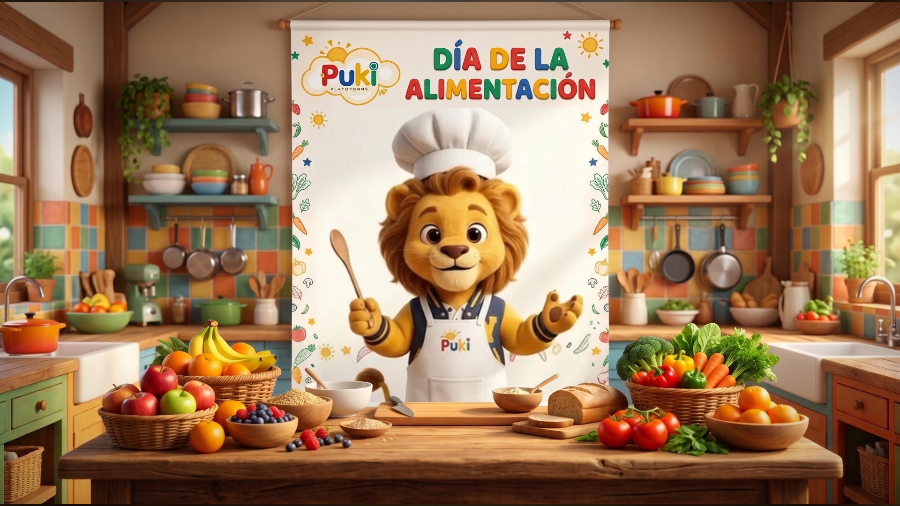

# Día de la Alimentación

Pantalla inmersiva para el **Día de la Alimentación** del Preescolar Puki. La
cocina ilustrada queda al frente y tres videos verticales de Yellow se
reproducen en bucle dentro del pendón central, a través del recorte transparente
del PNG.

**URL de producción:** https://puki-blue.vercel.app/dia-de-la-alimentacion/



## Uso local

- Abre `index.html` con doble clic (funciona con `file://`).
- O sirve la carpeta con cualquier servidor estático, por ejemplo:
  `python -m http.server 8000` y abre <http://localhost:8000/dia-de-la-alimentacion/>.

El video arranca automáticamente, silenciado y con `playsinline`. Si el
navegador bloquea la reproducción automática, aparece el aviso «Toca la pantalla
para comenzar».

## Estructura

| Archivo | Función |
| --- | --- |
| `index.html` | Marcado de las capas: escena, videos, PNG frontal y cortina. |
| `styles.css` | Composición 100vw × 100vh, recorte, z-index y adaptación. |
| `player.js` | Playlist secuencial con doble buffer y precarga. |
| `fuentes/Dia de la Alimentacion.png` | Cocina con el hueco alfa del pendón (2752 × 1536). |
| `fuentes/1.mp4`, `2.mp4`, `3.mp4` | Clips verticales 360 × 640, ~10 s cada uno. |
| `capturas/vista-general.png` | Captura de referencia a 1920 × 1080. |

## Capas

- **z-index 1 · `.video-slot`**: contenedor centrado (`left: 50%` +
  `translateX(-50%)`), de borde superior a inferior de la escena. Su ancho
  (864/2752) hace que la altura completa dé una relación 9:16 exacta, por lo
  que el video no se deforma. `pointer-events: none`.
- **z-index 2 · `.banner`**: PNG frontal con `object-fit: cover` y
  `pointer-events: none`. Solo deja ver el video por el alfa transparente.
- Las dos etiquetas `<video>` se alternan con una transición de opacidad de
  180 ms. Mientras una reproduce, la otra ya tiene precargado el siguiente
  clip, así que el cambio de `ended` es inmediato y sin pantalla negra.

## Editar la playlist

En `player.js`, al inicio:

```js
const SOURCES = [
  "fuentes/1.mp4",
  "fuentes/2.mp4",
  "fuentes/3.mp4",
];
```

Agrega o reordena rutas libremente: el ciclo vuelve al primer elemento. Si un
archivo falta o falla, se omite automáticamente y se continúa con el siguiente.

## Adaptación

La escena conserva su relación de aspecto y se centra; el espacio restante en
pantallas que no son 16:9 se rellena con la misma cocina desenfocada, sin barras
de desplazamiento. La composición está pensada para orientación horizontal; en
vertical se ve completa, con bandas ambientales arriba y abajo.
