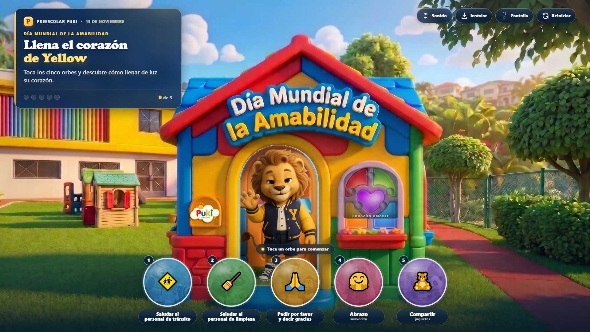

# Día Mundial de la Amabilidad · Preescolar Puki

PWA interactiva y táctil para educación preescolar. La maestra y los niños tocan cinco orbes de buenas acciones; cada orbe enciende una luz de la ventanita del corazón y, al completar los cinco, Yellow el león se transforma en superhéroe.



**Producción:** https://puki-blue.vercel.app/dia-mundial-amabilidad/

## Cómo abrir la actividad

La aplicación necesita un servidor local para que funcionen el service worker, la instalación como PWA y la reproducción de video. No abras `index.html` con doble clic.

### Opción recomendada (Windows)

1. Instala [Node.js 18 o superior](https://nodejs.org/) si aún no lo tienes.
2. Haz doble clic en `iniciar.cmd`.
3. Se abrirá el navegador en `http://localhost:4173/`.

### Opción con Python

Desde esta carpeta:

```powershell
python -m http.server 4173
```

Luego abre `http://localhost:4173/`.

### Opción manual con Node

```powershell
node servidor.mjs --open
```

Para usar otro puerto:

```powershell
$env:PORT=4174; node servidor.mjs --open
```

## Instalar como aplicación

Con la página abierta en `localhost` o en un sitio HTTPS:

- **Chrome / Edge en computadora:** usa el botón **Instalar** de la barra superior o el icono de instalación de la barra de direcciones.
- **Tablet Android:** menú del navegador → **Instalar aplicación** / **Añadir a pantalla de inicio**.
- **iPad:** Safari → Compartir → **Añadir a pantalla de inicio**.

La app se abre en horizontal y en pantalla completa. En la primera visita descarga los videos y los guarda en caché; después puede abrirse sin conexión desde el icono instalado.

> Para usarla en un aula con una tablet, publica la carpeta completa en un hosting HTTPS (GitHub Pages, Netlify, un servidor escolar, etc.). Los service workers no se activan al abrir el archivo directamente ni en `http://` desde otra computadora.

## Uso en el aula

| Acción | Resultado |
| --- | --- |
| Toca un orbe inferior | Reproduce el video de ese acto de amabilidad y enciende una luz del corazón. |
| Toca los cinco orbes | Yellow celebra con una de sus tres animaciones y, al quinto, comienza su transformación. |
| **Sonido** | Activa o silencia el audio de todos los videos de Yellow y de los orbes. |
| **Pantalla** | Entra o sale de pantalla completa. |
| **Reiniciar** | Apaga todas las luces, detiene los videos y vuelve al inicio para repetir la dinámica. |
| **Instalar** | Aparece cuando el navegador permite instalar la PWA. |

La actividad no requiere que los orbes se activen en un orden concreto: el clímax se dispara cuando se enciende la quinta luz.

## Estructura del proyecto

```text
index.html              Escena, portal, ventanita y orbes
styles.css              Composición 16:9, luces CSS y celebraciones
app.js                  Estados de video, progreso, sonido y reinicio
manifest.webmanifest    Configuración de instalación de la PWA
sw.js                   Caché sin conexión para toda la experiencia
servidor.mjs            Servidor local sin dependencias
iniciar.cmd             Lanzador para Windows
Fuentes/                Videos originales y fondo de la casita
icons/                  Iconos de la PWA
capturas/               Vistas previas de la actividad
```

## Personalización rápida

- **Textos y mensajes:** `VALUES` y los textos de `index.html` / `app.js`.
- **Duración de los videos:** se respeta la duración real de cada archivo. La celebración de Yellow vuelve a `yellow_idle.mp4` cuando termina su clip, no con un corte fijo.
- **Celebraciones de Yellow:** la rotación usa `yellow_happy.mp4`, `yellow_celebrate_2.mp4` y `yellow_celebrate_3.mp4`. Las tres aparecen antes de repetirse y nunca se reproduce la misma dos veces seguidas.
- **Nombre o fecha del evento:** misión superior en `index.html`.
- **Colores de los orbes:** variables `--orb-color` y `--orb-deep` en cada botón de orbe, o los estilos de `.heart-light`.
- **Videos:** conserva los nombres de archivo en `Fuentes/` o actualiza las rutas en `index.html` y la lista `CORE_ASSETS` de `sw.js`.

Si cambias videos o archivos cacheados manteniendo el mismo nombre, sube la versión de `CACHE_VERSION` en `sw.js` para que los dispositivos reciban la actualización.

## Detalles de implementación

- Escena panorámica 16:9 centrada con `cqw`/`cqh` para escalar tipografía y controles a cualquier pantalla.
- Los seis videos de Yellow (`idle`, las tres celebraciones, `transform` y `superhero`) son etiquetas `<video>` apiladas con `preload="auto"` y transiciones de opacidad de `0.2s`.
- La ventanita del corazón usa exclusivamente CSS para sus cinco luces: `blur()`, `box-shadow`, filtros y `color-mix()`.
- La celebración y la transformación avanzan con el evento `ended` de cada video, para reproducir siempre sus 10 segundos completos.
- La rotación de celebraciones usa una bolsa barajada: las tres se muestran antes de repetir y nunca se encadenan dos iguales.
- Respeta `prefers-reduced-motion`, incluye foco visible y textos alternativos para lectores de pantalla.
- Todos los videos de Yellow (`idle`, `happy`, `celebrate_2`, `celebrate_3`, `transform` y `superhero_idle`) incluyen su audio. Por las políticas de autoplay, el primer toque o clic en la pantalla es el que habilita el sonido; el control **Sonido** silencia o reactiva todos los videos.
